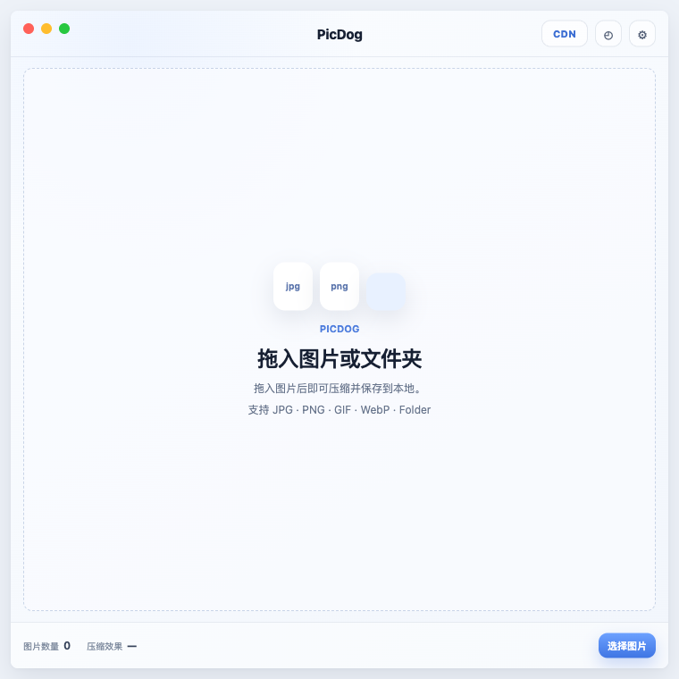
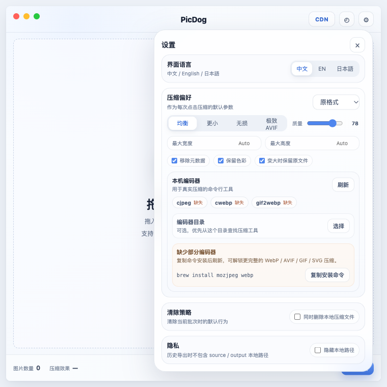
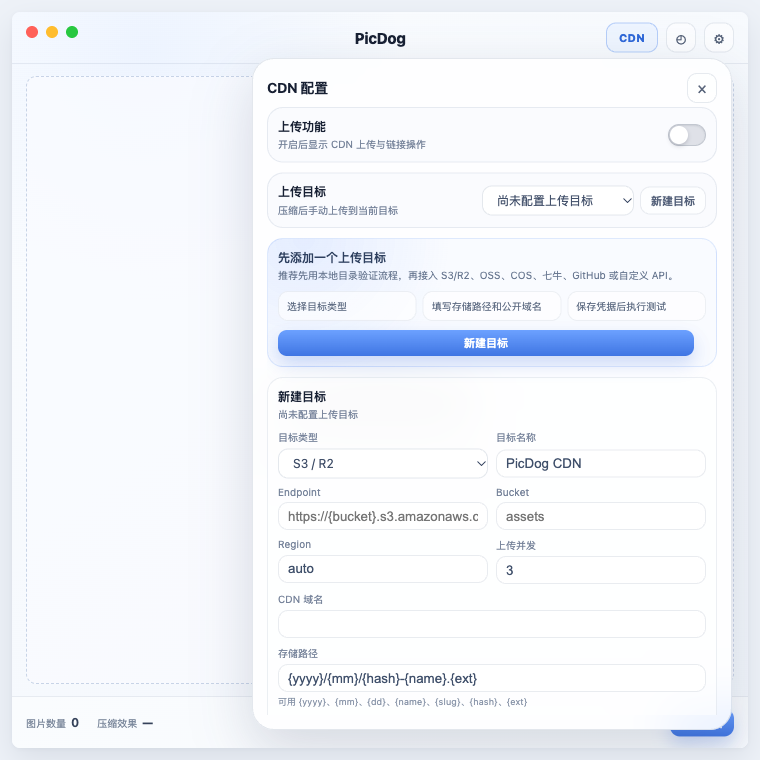
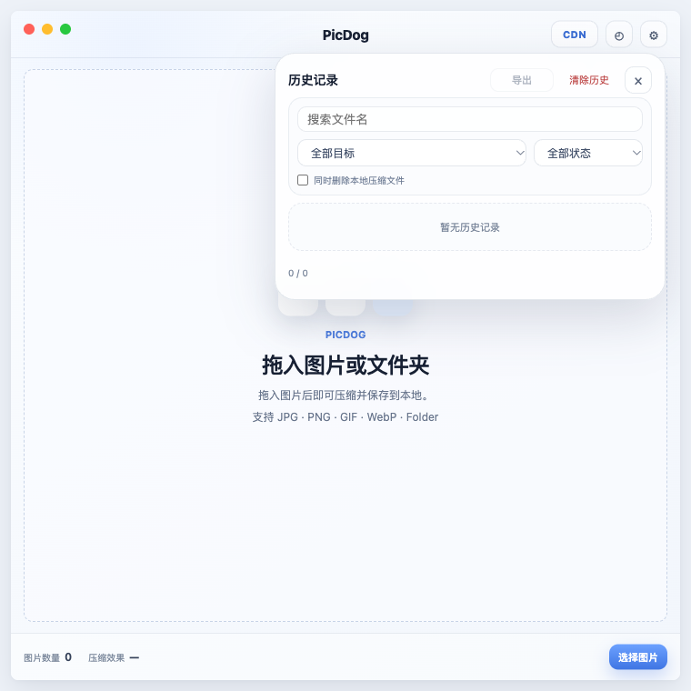

  

<h1 align="center">PicDog</h1>

  优雅、克制、面向发布工作流的桌面图片压缩与上传工具。

  自动压缩 · 手动上传 · CDN 链接复制 · 多图床支持 · macOS 小窗口体验

---

# PicDog 产品与技术文档

## 功能介绍

PicDog 是一款面向创作者、设计师、开发者和内容团队的桌面端图片压缩与上传工具。它把像 PPDuck 一样简单的本地压缩体验，和像 uPic / PicGo 一样灵活的图床发布能力整合到一个更现代、更克制的小窗口里：拖入图片后自动压缩；确认结果后，再手动上传；上传完成后，一键复制可发布的 CDN 链接。

PicDog 的核心定位是：

> 本地优先的图片压缩发布工作台。  
> 让每一张图片在发布前变得更小、更快、更好管理。

### 界面预览

| 主界面 | 设置 |
| --- | --- |
|  |  |

| CDN 配置 | 历史记录 |
| --- | --- |
|  |  |

### 核心卖点

- 拖入即自动压缩：支持图片和文件夹导入，适合博客、文档、设计交付、官网素材和应用截图批处理。
- 压缩自动开始，上传手动确认：PicDog 不做自动上传。用户导入后先获得本地压缩结果，再勾选需要发布的图片手动上传，避免误传、错传和多余的远端文件。
- 默认本地优先：压缩在本机完成，源图不会因为压缩流程自动离开设备。
- 凭据安全：Access Key、Secret、Token 等敏感凭据只进入系统钥匙串，数据库只保存 credentialRef。
- 上传完成后才能复制：每张图片有清晰的压缩进度和上传进度。只有 CDN 上传成功后，复制按钮才可用，降低复制本地路径、空链接或失败链接的风险。
- 前后对比：压缩完成后可打开图片对比浮层，通过滑杆查看压缩前后的视觉差异和体积变化。
- 多目标图床和静态存储：支持 S3 / Cloudflare R2、阿里云 OSS、腾讯云 COS、七牛云 Kodo、GitHub 仓库、本地目录、自定义 API。
- 多种链接格式：支持 URL、Markdown、HTML 和自定义模板。博客作者可以复制 Markdown，官网工程可以复制 URL，文档场景可以复制 HTML。
- 历史记录可追溯：保存压缩结果、上传状态、目标、链接和节省比例。用户可以重新复制、过滤查询，也可以清除历史和可选删除本地压缩产物。
- 现代 macOS 小窗口体验：无边框透明窗口、系统级阴影、圆角白灰界面、蓝色选中状态、紧凑列表、轻量设置弹窗，适合长期放在桌面或 Dock 中快速使用。
- 多语言界面：默认中文，支持 English 和日本語，并可在设置中切换。

### 典型使用场景

| 场景 | 用户动作 | PicDog 价值 |
| --- | --- | --- |
| 写博客 | 拖入截图，压缩后上传到 R2 / OSS，复制 Markdown | 降低图片体积，直接粘贴到文章 |
| 写技术文档 | 批量导入文档配图，上传后复制 HTML / URL | 统一 CDN 路径和缓存策略 |
| 设计交付 | 批量压缩导出的 PNG / JPG | 减少交付包体积，保留视觉质量 |
| 官网运营 | 压缩活动图并上传到静态存储 | 缩短发布链路，降低出错率 |
| 开发调试 | 本地目录作为上传目标 | 先验证流程，再切换到云端目标 |
| 团队规范 | 固定路径模板和复制格式 | 保持素材命名、缓存和链接格式一致 |

### 产品工作流

~~~mermaid
flowchart LR
  A[拖入图片或文件夹] --> B[自动本地压缩]
  B --> C[查看压缩结果]
  C --> D{是否上传}
  D -->|不上传| E[保留本地压缩文件]
  D -->|勾选图片| F[手动批量上传]
  F --> G[获得 CDN 链接]
  G --> H[复制 URL / Markdown / HTML / 自定义格式]
  H --> I[写入历史记录]
~~~

### 与同类工具的差异

PicDog 的设计参考了 GitHub 上长期受欢迎的图片处理和上传项目的优点，但把产品焦点收敛到压缩后发布这条主线。

| 参考方向 | 代表项目/产品 | PicDog 的取舍 |
| --- | --- | --- |
| 本地图片压缩 | ImageOptim、Squoosh、PPDuck | 保留拖拽压缩和优秀编码器，弱化复杂参数暴露 |
| 图床上传 | uPic、PicGo | 保留多 Provider 和链接复制，避免自动上传造成误操作 |
| 桌面应用 | Tauri 生态项目 | 用 Rust 承担文件、压缩、上传、凭据和系统能力 |
| 开发者体验 | Vite、React、TypeScript 项目 | 保持前端迭代快，状态模型清晰，类型契约可维护 |

PicDog 的目标不是堆满所有图像处理参数，而是把日常发布链路做得更顺：导入、压缩、选择、上传、复制，每一步都明确、可控、可恢复。

---

## 技术栈

| 层级 | 技术选型 | 作用 |
| --- | --- | --- |
| 桌面框架 | Tauri v2 | 小包体桌面容器、系统窗口、文件对话框、剪贴板、跨平台打包 |
| 前端 | React + TypeScript + Vite | UI 渲染、状态管理、交互原型快速落地 |
| 样式 | Vanilla CSS + Design Tokens | 维护白灰蓝视觉体系、圆角、阴影、毛玻璃质感 |
| 后端 | Rust | 文件扫描、压缩编排、上传、SQLite、系统凭据、错误脱敏 |
| 本地数据库 | SQLite + rusqlite | 设置、上传目标、批次、资源、历史记录 |
| 凭据存储 | keyring | macOS Keychain、Windows Credential Manager、Linux Secret Service |
| HTTP 客户端 | reqwest blocking client | 对象存储和图床上传 |
| 图片处理 | Rust image crate + 外部编码器 | 内建压缩兜底和专业编码器优先 |
| 打包 | Tauri bundle | 生成 macOS App / DMG，并内置 app icon / dock icon |

---

## 总体架构

PicDog 采用 React 负责体验，Rust 负责能力的架构。前端不直接处理本地文件和密钥，所有高权限操作都通过 Tauri command 进入 Rust 层；Rust 层通过事件把压缩和上传进度推回 UI。

~~~mermaid
flowchart TB
  UI[React UI 主面板 / 设置 / CDN / 历史] --> Commands[Tauri Commands]
  Commands --> State[AppState 内存批次 + SQLite]
  State --> DB[(SQLite)]
  Commands --> Compression[Compression Engine]
  Compression --> Builtin[Rust image 内建编码]
  Compression --> NativeTools[外部编码器 MozJPEG / WebP / AVIF / GIF / SVG]
  Commands --> Upload[Upload Engine]
  Upload --> Providers[S3/R2 / OSS / COS / Qiniu / GitHub / Local / Custom API]
  Upload --> Keychain[System Keychain]
  Compression --> Events[picdog://task-event]
  Upload --> Events
  Events --> UI
~~~

### 目录结构

~~~text
picdog/
  apps/
    desktop/
      src/
        app/                  # 应用入口、i18n、错误本地化、剪贴板封装
        components/           # WindowFrame 等通用 UI
        contracts/            # 前后端共享 TypeScript 契约
        features/
          batch/              # 文件列表、底部操作栏、批次状态机
          history/            # 历史记录弹窗
          settings/           # 设置与 CDN 配置弹窗
      src-tauri/
        src/
          commands/           # Tauri commands
          compression/        # 压缩引擎
          uploaders/          # 上传 Provider adapters
          storage/            # SQLite 持久化
          credentials.rs      # 系统凭据
          desktop_shell.rs    # 桌面窗口和系统能力
          models.rs           # Rust 数据模型
          state.rs            # 应用状态聚合
        migrations/           # SQLite schema
        icons/                # App / Dock 图标资源
  docs/                       # 产品和技术文档
  tests/                      # 核心业务模型测试
~~~

---

## 前端设计

### 前端目标

PicDog 前端的核心目标是让主链路集中在一个面板里，不让用户在多个页面之间来回跳转。当前主界面包含三个固定区块：

1. 顶部窗口栏：PicDog 标题、CDN 配置、历史记录、设置。
2. 中间工作区：空状态拖拽区或文件列表。
3. 底部操作栏：批次统计、清除、上传、复制、压缩等主操作。

设置、CDN 配置和历史记录都采用轻量弹窗。弹窗支持点击外部关闭、Esc 关闭、再次点击导航按钮关闭。点击外部时会拦截底层点击，避免关闭弹窗的同时误触发选择图片。

### 关键前端模块

| 模块 | 文件 | 职责 |
| --- | --- | --- |
| 应用主入口 | src/app/App.tsx | 组合窗口、设置、路由、历史、批次控制器 |
| 窗口框架 | src/components/WindowFrame.tsx | 无边框窗口、macOS 风格按钮、顶部导航 |
| 批次控制器 | src/features/batch/useBatchController.ts | 调用后端 command、监听 task event、更新批次 |
| 批次状态 | src/features/batch/batchState.ts | 判断 canUpload / canCopy / canReveal 和 BatchState |
| 文件列表 | src/features/batch/FileList.tsx | 展示图片行、选择框、压缩/上传进度、单项按钮 |
| 操作栏 | src/features/batch/ActionBar.tsx | 底部统计、清除、批量上传、复制和压缩 |
| 设置弹窗 | src/features/settings/SettingsPopover.tsx | 多语言、压缩默认参数、本机编码器、隐私 |
| CDN 配置 | src/features/settings/RouteSettingsPopover.tsx | 上传开关、Provider、路径模板、凭据保存、连接测试 |
| 历史弹窗 | src/features/history/HistoryPopover.tsx | 搜索、过滤、导出、清除历史 |
| 命令契约 | src/contracts/commands.ts | Tauri invoke 封装和浏览器预览 fallback |
| 数据模型 | src/contracts/models.ts | TypeScript 类型定义 |
| 事件契约 | src/contracts/events.ts | picdog://task-event 进度事件 |
| 多语言 | src/app/i18n.ts | 中文、英文、日文 UI 文案 |
| 错误文案 | src/app/errorMessages.ts | SafeError 本地化展示 |

### 前端状态模型

PicDog 用 Batch 表示一次导入和处理任务，用 AssetState 表示单张图片。前端不依赖隐藏状态推断按钮可用性，而是通过显式状态判断。

~~~ts
type BatchState =
  | 'empty'
  | 'queue'
  | 'compressing'
  | 'compressed'
  | 'uploading'
  | 'uploaded'
  | 'failed'
  | 'cancelling';

type CompressStatus = 'pending' | 'running' | 'done' | 'failed' | 'cancelled';
type UploadStatus = 'none' | 'pending' | 'running' | 'done' | 'failed' | 'cancelled';
~~~

关键规则：

- canUpload(asset)：压缩完成、有 outputPath、未上传完成、未在上传中。
- canCopy(asset)：上传完成且有 publicUrl。
- canReveal(asset)：压缩完成且有 outputPath。
- 默认导入后自动压缩但不自动上传，用户需要勾选图片后触发批量上传。
- 复制按钮在 CDN 上传完成前不可点击。

### 前后端通信

前端通过 picdogCommands 封装所有 Tauri 调用。每个 command 都提供浏览器预览 fallback，因此 UI 可以在普通浏览器里预览，不依赖 Tauri runtime。

主要 command：

| Command | 用途 |
| --- | --- |
| select_files | 打开系统文件选择器 |
| scan_dropped_paths | 扫描拖拽文件和目录 |
| create_batch | 创建当前批次 |
| get_batch / get_latest_batch | 恢复批次 |
| read_image_preview | 读取本地图片预览 |
| start_compression | 启动压缩 |
| upload_assets | 上传选中资源 |
| copy_link | 按 URL / Markdown / HTML / custom 复制 |
| mark_link_copied / mark_links_copied | 标记复制状态 |
| clear_batch | 清除当前批次，可选删除压缩产物 |
| cancel_task | 请求取消当前任务 |
| reveal_output | 在 Finder 中显示压缩文件 |
| list_routes / save_route / delete_route | 上传目标管理 |
| save_route_credential / delete_route_credential | 凭据管理 |
| test_route | 上传目标连通性测试 |
| get_settings / save_settings | 设置读写 |
| list_history / clear_history | 历史记录查询和清除 |

### 进度事件

压缩和上传是长任务，前端通过事件实时更新 UI。事件名统一为 picdog://task-event。

事件类型包括：

- batch.created
- batch.status.changed
- asset.compress.started
- asset.compress.progress
- asset.compress.done
- asset.upload.started
- asset.upload.progress
- asset.upload.done
- asset.cancelled
- asset.failed
- queue.idle

这种设计避免了前端轮询，也让列表行的进度条可以细粒度更新。

### UI/UX 设计原则

- 一个面板完成主链路：避免把压缩、上传、复制拆成多个页面。
- 低频功能收进设置：语言、压缩默认项、编码器目录、隐私、上传目标都在弹窗里。
- 进度贴近文件：每张图片下方显示压缩和上传进度条，用户能直接定位问题文件。
- 按钮跟状态绑定：未压缩不能上传，未上传不能复制，减少误操作。
- 浅色 macOS 风格：白灰底、柔和阴影、小圆角、低饱和蓝色强调。

---

## Rust / Tauri 后端设计

### 后端目标

Rust 层负责所有需要系统能力、文件权限、性能和安全边界的逻辑：

- 扫描本地文件和文件夹。
- 创建和恢复批次。
- 调用图片压缩器。
- 上传到对象存储或图床。
- 保存设置、历史和批次状态。
- 管理系统凭据。
- 输出安全错误。
- 向前端推送实时进度。

### Tauri 初始化

src-tauri/src/lib.rs 注册 Tauri commands，并挂载应用状态。desktop_shell.rs 负责桌面窗口细节，例如无边框窗口、透明背景、系统阴影和窗口控制。

后端状态由 AppState 聚合：

- SQLite storage
- 内存批次缓存
- 取消任务标记
- 历史记录写入
- 批次恢复

### 数据模型

Rust 和 TypeScript 使用同构字段，统一采用 camelCase 与 serde 映射，减少前后端转换成本。

核心模型：

| 模型 | 说明 |
| --- | --- |
| FileInput | 文件路径、文件名、大小、MIME、是否目录 |
| Batch | 一批导入资源的整体状态 |
| AssetState | 单张图片的压缩状态、上传状态、路径、体积、链接、错误 |
| CompressionOptions | 压缩模式、质量、输出格式、尺寸限制、metadata 策略 |
| Route | 上传目标配置 |
| RouteCredentialInput | AccessKey、Secret、SessionToken、ApiToken |
| AppSettings | 语言、默认目标、复制格式、压缩默认值、隐私设置 |
| HistoryItem | 历史记录展示字段 |
| SafeError | 可展示、可恢复、可重试的安全错误 |

### SQLite 存储设计

数据库初始 schema 位于 src-tauri/migrations/0001_init.sql。

| 表 | 内容 |
| --- | --- |
| settings | app 设置 JSON |
| routes | 上传目标配置，不保存明文密钥 |
| batches | 批次摘要、总文件数、上传数、总体积、清除状态 |
| assets | 单图记录、源路径、输出路径、压缩/上传状态、CDN URL、错误信息 |

敏感凭据不进入 SQLite。routes.credential_ref 只保存系统凭据引用，例如 keychain://picdog/{routeId}。

清除策略采用软删除：

- clear_batch 会给当前批次和资产打 cleared_at。
- clear_history 可以按全部、当前筛选、选中项清除。
- 如果用户勾选删除本地压缩文件，Rust 只删除 PicDog 生成的安全输出文件。
- 代码会拒绝非法 history scope，避免错误参数误删数据。

### 压缩引擎

PicDog 的压缩策略是专业外部编码器优先，Rust 内建编码兜底。

#### 支持格式

| 输入/输出 | 策略 |
| --- | --- |
| JPEG | 优先 MozJPEG cjpeg，内建 JPEG 兜底 |
| PNG | 优先 pngquant + oxipng，内建 PNG 兜底 |
| WebP | 优先 cwebp |
| AVIF | 优先 avifenc，面向极致压缩 |
| GIF | 优先 gifsicle 优化，GIF 转 WebP 使用 gif2webp |
| SVG | 优先 svgo |
| 其它 | 返回 unsupported_format 或保留原始 |

#### 压缩参数

CompressionOptions 支持：

- mode：balanced / tiny / lossless / retina / extreme_avif / custom
- quality：质量参数
- outputFormat：original / webp / avif / jpg / png
- maxWidth / maxHeight：等比缩放限制
- stripMetadata：移除元数据
- preserveColorProfile：保留色彩信息
- keepOriginal：保留原图
- fallbackWhenLarger：压缩后变大则保留原文件

默认配置是 balanced：

- quality：78
- outputFormat：original
- stripMetadata：true
- preserveColorProfile：true
- keepOriginal：true
- fallbackWhenLarger：true

#### Resize 策略

当前实现支持等比缩放，不放大原图：

- JPEG / PNG 使用 Rust image 解码后 resize。
- WebP 到 WebP 使用 cwebp -resize。
- GIF 到 GIF 使用 gifsicle --resize-fit。
- 外部编码器不支持直接 resize 的组合会先生成受限尺寸的中间图，再进入目标编码流程。

#### 结果保护

压缩完成后会比较源文件和输出文件大小：

- 如果 fallbackWhenLarger = true 且输出更大，PicDog 会删除变大的输出文件。
- 资产会指回源路径，节省比例记为 0。
- 这样可以避免压缩后反而变大的结果进入用户工作流。

### 上传引擎

上传层采用 Provider Adapter 模式。统一入口是 uploaders::upload_object，根据 Route.provider 分发到具体实现。

支持 Provider：

| Provider | 文件 |
| --- | --- |
| S3 / Cloudflare R2 | uploaders/s3.rs |
| 阿里云 OSS | uploaders/aliyun_oss.rs |
| 腾讯云 COS | uploaders/tencent_cos.rs |
| 七牛云 Kodo | uploaders/qiniu.rs |
| GitHub 仓库 | uploaders/github.rs |
| 本地目录 | uploaders/local_folder.rs |
| Custom API | uploaders/custom_api.rs |

#### Route 配置

每个上传目标包含：

- provider
- endpoint
- bucket
- region
- pathTemplate
- publicBaseUrl
- cacheControl
- defaultCopyFormat
- customLinkTemplate
- custom API method/body/file field/header/url path
- concurrency
- credentialRef

路径模板支持：

~~~text
{yyyy}/{mm}/{dd}/{hash}-{name}.{ext}
~~~

这使输出 URL 具备稳定、可缓存、可追溯的命名策略。

#### 连接测试

test_route 会创建一个临时文本文件，上传到固定测试路径：

~~~text
__picdog_route_test__/connection.txt
~~~

上传成功后会尝试删除测试对象，并返回 public URL，用于验证凭据、路径、域名和权限是否正确。

#### 重试策略

上传层只对临时性错误重试：

- 5xx
- 408 Request Timeout
- 429 Too Many Requests

不会对 400、401、403 等明显配置或权限错误盲目重试，避免浪费时间并快速暴露问题。

### 凭据安全

credentials.rs 使用 keyring 保存敏感信息。PicDog 的设计原则是：

- SQLite 只保存 credentialRef。
- 前端不会持久化 AccessKey / Secret / Token。
- 保存凭据时写入系统安全存储。
- 删除上传目标或删除凭据时清理对应 keychain item。
- 错误信息通过 SafeError 返回，不把密钥拼进 message。

### 错误模型

后端统一返回 SafeError：

~~~rust
pub struct SafeError {
    pub code: String,
    pub message: String,
    pub recoverable: bool,
    pub retryable: bool,
}
~~~

前端根据 code 做本地化展示，避免把后端实现细节直接暴露给用户。常见错误包括：

- unsupported_format
- file_not_found
- encoder_missing
- compression_failed
- upload_disabled
- credential_missing
- permission_denied
- network_timeout
- route_not_found
- asset_not_uploaded
- invalid_history_scope
- storage_error
- clipboard_failed

---

## 关键业务流程

### 1. 导入文件

~~~mermaid
sequenceDiagram
  participant U as User
  participant UI as React UI
  participant R as Rust Command
  participant S as AppState/SQLite

  U->>UI: 拖入图片或文件夹
  UI->>R: scan_dropped_paths(paths)
  R->>R: 扫描目录 / 过滤格式 / 去重
  R-->>UI: FileInput[]
  UI->>R: create_batch(files)
  R->>S: upsert_batch
  R-->>UI: Batch
~~~

### 2. 压缩

~~~mermaid
sequenceDiagram
  participant UI as React UI
  participant R as Rust Command
  participant C as Compression Engine
  participant DB as SQLite

  UI->>R: start_compression(batchId, options)
  R-->>UI: asset.compress.started
  R->>C: compress_asset(asset, options)
  C->>C: 选择格式 / resize / 编码 / fallback
  C-->>R: CompressionOutcome
  R->>DB: upsert_batch + history
  R-->>UI: asset.compress.done
  R-->>UI: queue.idle
~~~

### 3. 上传

~~~mermaid
sequenceDiagram
  participant UI as React UI
  participant R as Rust Command
  participant K as Keychain
  participant P as Provider
  participant DB as SQLite

  UI->>R: upload_assets(batchId, assetIds, routeId)
  R->>K: load_route_credential
  R-->>UI: asset.upload.started
  R->>P: upload_object(localPath, remoteKey)
  P-->>R: publicUrl
  R->>DB: 写入 public_url / uploaded_at / route
  R-->>UI: asset.upload.done
~~~

### 4. 复制链接

~~~mermaid
flowchart LR
  A[用户点击复制] --> B{asset.uploadStatus == done?}
  B -->|否| C[禁用按钮]
  B -->|是| D[copy_link]
  D --> E[按 URL / Markdown / HTML / custom 渲染]
  E --> F[写入系统剪贴板]
  F --> G[mark_link_copied]
~~~

---

## 测试和质量保障

当前项目已经具备三类验证：

| 类型 | 命令 | 覆盖 |
| --- | --- | --- |
| 前端构建 | pnpm build | TypeScript、Vite build |
| 核心业务测试 | node tests/core.test.mjs | 压缩预设、复制模板、路径模板、历史清除等 |
| 桌面完整检查 | pnpm check | 前端 build、Rust fmt、Rust 单元测试 |

Rust 单元测试覆盖：

- route 校验和默认 publicBase URL。
- S3 / OSS / COS / Qiniu / GitHub / Local / Custom API 上传参数。
- 重试状态码判断。
- SQLite 批次恢复、历史清除、默认设置 seed。
- 压缩输出格式、resize、fallbackWhenLarger、工具查找。
- 安全删除 PicDog 输出文件。
- 上传功能默认关闭和开启后的权限判断。

---

## 打包与图标

PicDog 已生成新的品牌图标资源：

| 文件 | 用途 |
| --- | --- |
| src-tauri/icons/picdog-icon.svg | 可维护源文件 |
| src-tauri/icons/icon.png | 1024 主图标 |
| src-tauri/icons/icon.icns | macOS App / Dock |
| src-tauri/icons/icon.ico | Windows |
| src-tauri/icons/32x32.png | 小尺寸 PNG |
| src-tauri/icons/128x128.png | 标准 PNG |
| src-tauri/icons/128x128@2x.png | Retina PNG |

tauri.conf.json 已显式声明 bundle icon，debug 打包会生成：

- target/debug/bundle/macos/PicDog.app
- target/debug/bundle/dmg/PicDog_0.1.0_aarch64.dmg

---

## 后续路线图

### 近期优先级

- 压缩质量对比预览。
- 复制全部链接时支持按当前复制格式合并输出。
- 上传失败重试按钮和失败项过滤。
- 更完整的编码器状态检测和安装引导。
- 历史记录导出格式增强。
- 上传目标导入/导出模板。

### 中期能力

- 菜单栏入口。
- 剪贴板图片导入。
- 截图后压缩。
- Finder Share Extension。
- 全局快捷键。
- CLI 上传命令。
- 暗色模式。
- Provider 插件化。

### 长期方向

- 团队共享上传目标模板。
- 图片质量评分和视觉差异检测。
- WebP / AVIF 多版本输出和 fallback manifest。
- 静态站点框架集成。
- 自动生成 responsive image srcset。
- 基于项目的素材管理和远端清理。

---

## 一句话介绍

PicDog 是一款优雅、克制、面向发布工作流的桌面图片工具：拖入图片，自动本地压缩，手动上传，一键复制 CDN 链接。

PicDog 是为博客作者、开发者、设计师和内容团队打造的桌面端图片压缩发布工具。你可以把截图、设计稿或整组素材直接拖进窗口，PicDog 会立即在本地完成压缩优化，并清楚展示每张图片的压缩和上传进度。需要发布时，只要勾选图片并选择上传目标，就能把压缩后的文件上传到 S3/R2、OSS、COS、七牛、GitHub、本地目录或自定义 API。上传成功后，PicDog 会按 URL、Markdown、HTML 或自定义模板生成链接，一键复制到剪贴板。

PicDog 关注的是发布前的最后一公里：图片更小、链接正确、凭据安全、流程可控。

